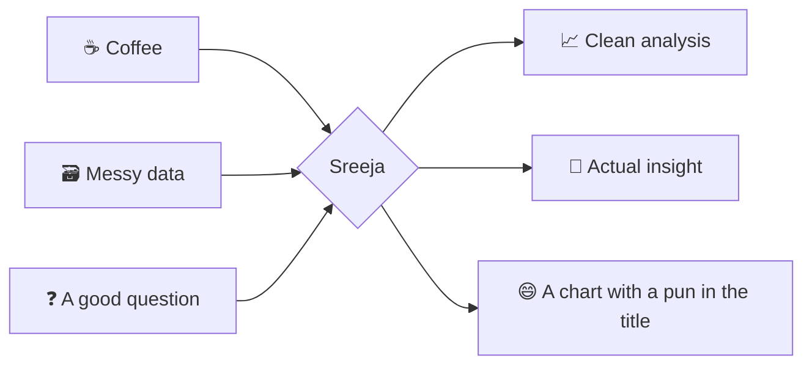

<!-- Replace every YOUR-USERNAME / YOUR-LINKEDIN / YOUR-EMAIL placeholder before publishing -->

<div align="center">  <a href="https://git.io/typing-svg">  </a>

**MSc Economics & Social Sciences @ Bocconi** · **BSc (Hons) Economics, Minor in Statistics @ NUS**
🇸🇬 Singapore ⇄ 🇮🇹 Milan

</div>

---

## 📊 Estimation Output

```stata
. reg sreeja_is_a_good_hire skills curiosity playfulness coffee, robust

Linear regression                               Number of obs     =         1
                                                R-squared         =    1.0000
                                                (Referee 2: "n is too small")
------------------------------------------------------------------------------
             |               Robust
      Hire   |      Coef.   Std. Err.      t    P>|t|     [95% Conf. Interval]
-------------+----------------------------------------------------------------
econometrics |      ↑↑↑       tiny      large   0.000      very      positive
      python |      ↑↑        tiny      large   0.000      quite     positive
   curiosity |      ↑↑↑       0.00        ∞     0.000      endlessly curious
 playfulness |      ↑↑        tiny      large   0.000      see this README
      coffee |      ↑         ¯\_(ツ)_/¯  ...   0.049      just barely
       _cons |  "a researcher who actually enjoys this"
------------------------------------------------------------------------------
Note: Standard errors clustered at the level of "one person, very motivated."
```

---

## 🧑‍💻 `whoami`

```python
class Sreeja:
    def __init__(self):
        self.trained_in   = ["Economics", "Statistics", "Econometrics"]
        self.schools      = {"NUS": "BSc (Hons) Economics", "Bocconi": "MSc Econ & Social Sciences"}
        self.obsessed_with = ["behavioural economics", "climate & carbon data",
                              "why people do what they do (and how to measure it)"]
        self.superpower   = "econometric intuition + willingness to clean very messy data"
        self.currently    = "writing a thesis on how weather shocks reshape our day — and our carbon footprint"

    def utility(self, problem):
        return problem.messiness * problem.real_world_relevance  # higher is better 🙂
```

---

## 🧪 Research Agenda (a.k.a. Projects)

| | Project | What it does | Stack |
|---|---|---|---|
| 🌡️ | **Carbon-Time Thesis** | Replicates & extends *Druckman et al. (2012)*: maps how Americans spend their day (ATUS) to carbon footprints, then asks what happens when the weather goes weird | Python · PostgreSQL · ERA5 / Copernicus API |
| 📰 | **Climate Headlines vs. Disasters** | Do climate news headlines react to disasters? VADER sentiment + LDA topic modelling in an event-study design with EM-DAT data | Python · NLP |
| 🇭🇷 | **Forecasting Croatian GDP** | Pitting AR and VAR models against each other to forecast GDP (spoiler: macro is hard) | R · LaTeX/Beamer |
| 📉 | **Volatility Forecasting** | Modelling volatility — currently being upgraded to run on real market data | Python |

> 🔗 Swap the project names above for links to the repos once they're public.

---

## 🧰 Toolkit

<p>
  
  
  
  
  
  
  
  
</p>

**Methods I reach for:** time series (AR/VAR, volatility) · event studies · RCTs & A/B tests · sentiment analysis & topic modelling · quasi-experimental designs

---

## 🏭 My Production Function



*Returns to scale: increasing, conditional on input C.*

---

## 📜 Assumptions (ceteris paribus)

- **A1.** I've done research on internet shutdowns, Singapore's water-sector workforce, and how temperature changes your Tuesday.
- **A2.** I ran A/B tests in industry before I ran them in my head at the supermarket.
- **A3.** I genuinely believe behavioural economics is the most fun corner of the discipline. Not up for debate. (Okay, slightly up for debate.)
- **A4.** I write things up properly — a result you can't explain is just a number.

---

## 📬 Market Clearing

I'm looking for roles in **quant / data-heavy research, economic consulting, and behavioural insights**.
If excess demand exists, let's talk:

<p>
  <a href="https://www.linkedin.com/in/sreeja-banerjee-a427581a0"></a>
  <a href="mailto:sreejab77@gmail.com"></a>
</p>

<div align="center">


<sub>H₀: you'll enjoy working with me. Fail to reject. ✨</sub>

</div>
